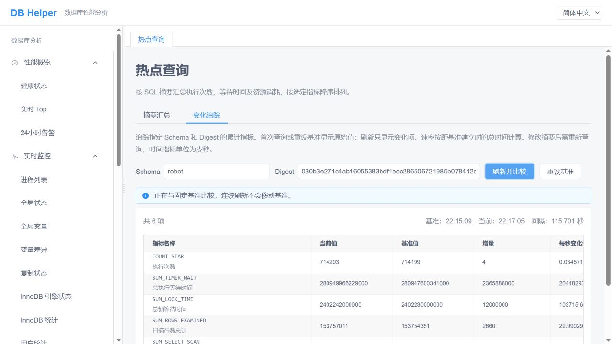

# 热点查询：追踪一条 SQL 的变化

你在热点查询里发现一条 SQL：执行次数很多，扫描的行数也不少。但这些数字可能已经积累了很长时间。它最近还在频繁执行吗？刚才的一次业务操作，又让它多扫描了多少行？

“变化追踪”就是用来回答这些问题的。先记下现在的数字，过一会儿再看，两次之间增加的部分，就是这段时间里发生的变化。

如果还不熟悉热点查询的列表，可以先阅读 [《从摘要汇总找到值得关注的 SQL》](digest-summary.md)。

## 先认识三个词

**Digest，可以把它理解为一类 SQL 的指纹。** 语句中具体的参数值通常会被归一化。例如，下面两次查询通常会归入同一个摘要：

```sql
SELECT * FROM orders WHERE id = 100;
SELECT * FROM orders WHERE id = 200;
```

所以，变化追踪关注的是这类查询的整体表现。同一数据库下，不同连接执行的同类 SQL，也会计入这份统计。

**基准，就是观察开始时拍下的一张“数字快照”。** 比如开始时执行次数是 100，后来变成 130，便知道观察期间又执行了 30 次。

**每秒变化量，就是这段观察时间里的平均速度。** 如果这 30 次发生在一分钟内，平均就是每秒 0.5 次。它描述的是一段时间的平均情况。

## 第一步：在摘要汇总里找到想观察的 SQL

打开左侧菜单的 **性能模式 → 热点查询**，进入 **摘要汇总** 页签。

1. 选择排序指标。例如，想找扫描数据较多的查询，可以按“扫描行数总计”排序。
2. 选择最近出现范围和返回条数，点击 **查询**。
3. 找到要观察的那一行，点击右侧操作列里的 **查看变化**。

页面会切换到 **变化追踪**，自动填入 Schema 和 Digest，并读取一次数据作为基准。Schema 可以理解为这份统计所属的数据库名称，Digest 则用于定位具体的 SQL 摘要，无需手动复制那一长串标识。

这里有个小区别：“最近出现范围”用来筛选摘要列表中最近出现过的查询。它不会把累计统计转换为这几分钟的统计，也不会决定变化追踪的观察时长。变化追踪从建立基准的那一刻开始计时。

## 第二步：建立基准，留出一点观察时间

首次进入时，页面会提示：

> 当前显示原始采样值，已作为比较基准。点击刷新并比较查看变化。

此时表格展示的是当前的累计值。即使执行次数已经很大，也不用担心，后面的比较会扣除这个起点。

接下来可以等待正常业务运行一段时间，或者在业务页面进行一次你想观察的操作，然后回到这里。

变化追踪只读取 MySQL 已采集的统计，不会替你执行选中的那条 SQL。

## 第三步：点击“刷新并比较”

点击 **刷新并比较** 后，表格会增加“基准值”“增量”和“每秒变化量”几列，并且只显示发生变化的指标。



*图：真实界面的一个采样示例。实际使用时，数值和时间会随业务活动变化；表格较宽时，可以横向滚动查看右侧列。*

截图里，观察时间大约是 115.7 秒。看第一行 `COUNT_STAR`（执行次数）：

| 当前值 | 基准值 | 增量 | 每秒变化量 |
| --- | --- | --- | --- |
| 714203 | 714199 | 4 | 约 0.0346 |

这表示：从建立基准到这次刷新，这类 SQL 又执行了 4 次，平均每秒执行约 0.0346 次。

再看 `SUM_ROWS_EXAMINED`（扫描行数总计），增量为 2660，表示这段时间累计又扫描了 2660 行。结合执行次数一起看，便能对这些查询的扫描量有一个直观印象。

## 连续刷新，起点会变吗？

不会。只要没有重设基准或更换追踪目标，每次刷新都与最初的基准比较。

比如，开始时执行次数是 100：

| 操作 | 当前执行次数 | 与基准相比增加 | 平均每秒增加 |
| --- | --- | --- | --- |
| 建立基准 | 100 | — | — |
| 1 分钟后刷新 | 130 | 30 | 0.5 |
| 2 分钟后再次刷新 | 150 | 50 | 约 0.4167 |

第二次刷新的增量是 50，每秒变化量也按完整的两分钟计算。

因此，观察时间越长，显示的平均速度越容易平滑掉短暂波动。如果你想专门观察接下来的一次操作，先重设基准会更方便。

## 什么时候点“重设基准”？

**重设基准** 会重新读取当前数据，把这一刻作为新的观察起点。

例如，你准备对比一次页面操作带来的数据库开销，可以这样做：

1. 选中要观察的 SQL 摘要，点击 **重设基准**。
2. 到业务页面完成一次操作。
3. 回到变化追踪，点击 **刷新并比较**。
4. 查看执行次数、扫描行数、锁等待等指标增加了多少。

重设后，表格会重新显示原始值，下一次刷新才会展示新的比较结果。这个按钮只更新当前页面的观察起点，不会清空 MySQL 的统计数据。

如果还有其他用户或后台任务同时执行这类 SQL，它们产生的变化也会统计进来。做前后对比时，尽量选择业务负载相近的时段。

## 这些指标，可以先看哪几个？

不需要一开始就看懂所有指标。先关注下面几项，就能回答不少日常问题。

| 指标 | 可以帮助你了解什么 |
| --- | --- |
| `COUNT_STAR` | 这类 SQL 又执行了多少次？ |
| `SUM_ROWS_EXAMINED` | 累计又扫描了多少行？ |
| `SUM_ROWS_SENT` | 累计向客户端返回了多少行？ |
| `SUM_TIMER_WAIT` | 累计执行等待时间增加了多少？ |
| `SUM_LOCK_TIME` | 累计锁等待时间增加了多少？ |
| `SUM_CREATED_TMP_DISK_TABLES` | 是否增加了磁盘临时表？ |
| `SUM_NO_INDEX_USED` | 未使用索引的执行次数有没有增加？ |
| `SUM_ERRORS`、`SUM_WARNINGS` | 是否出现了新的错误或警告？ |

有些时间数字看起来特别大，是因为页面目前保留了 MySQL 的原始单位：**皮秒**。1 秒等于 1,000,000,000,000 皮秒，不能直接把这些数字当成毫秒。

时间指标的“每秒变化量”也沿用这个单位。例如，`SUM_TIMER_WAIT` 的速率表示每秒累计增加多少皮秒的执行等待时间，不能把它当作某一次 SQL 的耗时。

变化追踪目前比较的是可以累加的指标。摘要汇总里的平均值、最大值、最小值和分位数等，没有直接放到这里作差比较。

## 换一条 SQL，重新开始观察

回到 **摘要汇总**，在另一行点击 **查看变化**，页面会自动切换目标，并为它重新建立基准。

再次点击同一行的“查看变化”，也会重新建立基准。如果只是想继续原来的观察，直接切换回 **变化追踪** 页签即可。

也可以手动修改 Schema 和 Digest。修改后，原来的基准会失效，点击“刷新并比较”将先为新目标建立基准，之后再刷新才有比较结果。Digest 应为 32 或 64 位十六进制标识，通常从摘要列表带入最方便。

Schema 留空表示追踪“没有指定默认数据库”的那份摘要统计，不表示查询所有数据库。

## 遇到这些情况，不用困惑

**刷新后表格空了。** 如果提示“没有匹配的变化项”，说明本次比较没有发现指标变化。可以让业务继续运行一会儿，再手动刷新。

**提示找不到摘要记录。** 这份记录可能尚未采集，也可能已经被清理或淘汰。页面会放弃旧基准，下次找到记录时重新开始观察。

**提示累计计数下降，已重新建立基准。** 数据库重启或统计重置后，累计值可能变小。页面会自动把新数据作为起点，避免显示没有意义的负增量。

**有些行的“查看变化”不能点击。** 空 Digest 的行属于汇总记录，无法定位到某一个 SQL 摘要，因此不能单独追踪。

**关闭页面后，之前的观察还在吗？** 基准保存在当前页面中。刷新整个浏览器页面，或关闭对应的工作区页签后，需要重新建立基准；这里暂时不保存历史观察记录。

页面支持简体中文、正体中文和英文，可以通过右上角的语言选择框切换。指标代码会保持原样，方便与 MySQL 的其他工具对照。
