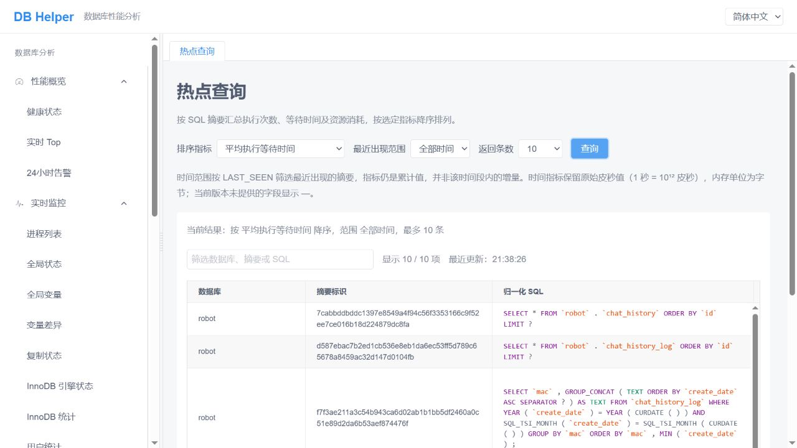

# 热点查询：从摘要汇总找到值得关注的 SQL

数据库里每天会执行很多 SQL。想知道哪些查询消耗的时间最多、扫描的数据最多，逐条翻日志往往很费劲。

“摘要汇总”把同类 SQL 的执行情况放在一起，再按你关心的指标排序。你可以先用它找到值得关注的查询，再进入“变化追踪”，观察它们接下来一段时间的表现。

## 表格里的一行代表什么？

一行通常代表某个数据库下的一类 SQL。比如下面两条查询，虽然订单编号不同，但结构相同，通常会归到同一个摘要：

```sql
SELECT * FROM orders WHERE id = 100;
SELECT * FROM orders WHERE id = 200;
```

表格中的“归一化 SQL”可能显示为：

```sql
SELECT * FROM orders WHERE id = ?;
```

其中的问号代表被归一化的参数值。旁边的“摘要标识”（Digest）是这类语句的指纹，便于准确定位。因此，执行次数、扫描行数和等待时间等数据，汇总了这类 SQL 的多次执行，也可能来自不同的数据库连接。

## 先查一次，熟悉页面

打开左侧 **性能模式 → 热点查询**，选择 **摘要汇总** 页签。页面进入时会自动查询一次，默认按总执行等待时间排序，筛选最近 1 分钟出现过的摘要，最多返回 5 条。



*图：摘要汇总的实际采样界面，示例按平均执行等待时间排序，范围为全部时间，返回 10 条。截图拍摄于增加“变化追踪”页签之前；当前版本的主要查询控件相同，并增加了页签和“查看变化”操作。*

日常操作只需要几步：

1. 选择一个 **排序指标**，决定想先看哪种开销。
2. 选择 **最近出现范围**，缩小到近期还在执行的查询。
3. 选择 **返回条数**，点击 **查询**。
4. 查看 SQL 和相关指标。表格字段较多，可以横向滚动查看右侧列。

修改上面的下拉选项后，需要再次点击“查询”，结果才会更新。页面上的“当前结果”和“最近更新”可以帮助你确认正在看的数据。

## 排序指标，怎么选？

所有排序都是从大到小。排在前面，表示所选指标更高，值得结合业务进一步了解。

刚开始可以先用这几种角度：

| 想了解的问题 | 可以选择的排序指标 | 看结果时注意什么 |
| --- | --- | --- |
| 哪类查询累计占用了较多执行时间？ | 总执行等待时间 | 可能是单次较慢，也可能是执行得特别频繁 |
| 哪类查询平均每次执行较慢？ | 平均执行等待时间 | 同时看看执行次数，少量执行也可能排在前面 |
| 哪类查询累计扫描的数据多？ | 扫描行数总计 | 结合返回行数和业务用途判断 |
| 哪类查询累计锁等待较多？ | 总锁等待时间 | 可以继续观察是否仍在增长 |
| 哪类查询产生了较多磁盘临时表？ | 创建磁盘临时表总数 | 可以进一步检查相关查询的排序、分组等操作 |

例如，两类查询的情况是：

| 查询 | 执行次数 | 平均每次耗时 | 总耗时 |
| --- | --- | --- | --- |
| A | 10,000 次 | 2 毫秒 | 20 秒 |
| B | 10 次 | 500 毫秒 | 5 秒 |

按总时间看，A 排在前面；按平均时间看，B 排在前面。两个排序回答的是不同问题，可以来回切换着看。

其他排序项也可以按下面的含义理解：

| 排序指标 | 简单理解 |
| --- | --- |
| 返回行数总计 | 累计向客户端返回了多少行 |
| 创建临时表总数 | 累计创建了多少临时表 |
| 全表扫描式 JOIN 累计次数 | 连接查询中出现相应扫描情况的累计次数 |
| SELECT 扫描次数 | SELECT 出现表扫描的累计次数 |
| 排序归并累计次数 | 排序时累计发生了多少次归并过程 |
| 排序行数总计 | 累计参与排序的行数 |
| 未使用索引累计次数 | 未使用索引的执行次数 |
| 未使用合适索引累计次数 | 未使用合适索引的执行次数 |

扫描或未使用索引的次数较高，可以作为继续检查的线索。是否需要优化，还要看表大小、实际耗时和业务需求。

## “最近 5 分钟”到底是什么意思？

这个选项很容易误读。**最近出现范围按“最近出现时间”筛选摘要，表格里的指标仍保留累计值。**

举个例子：一类 SQL 早上已经执行了 1000 次，最近一分钟又执行了 2 次。选择“最近 1 分钟”时，它会出现在列表中，执行次数可能显示为 1002。所以这个范围适合用来回答：“哪些查询最近还出现过？”

如果想知道“从现在开始，它又执行了多少次？”，就要使用 [变化追踪](digest-changes.md)。

范围可以选择 1 分钟、5 分钟、30 分钟、1 小时、4 小时、半天、一天和全部时间。“全部时间”表示不按最近出现时间筛选，展示的仍是 MySQL 当前保留的摘要统计，不是一份永久历史记录。数据库重启或统计被清理后，数据可能重新开始累计。

## 返回条数和关键字筛选，有什么区别？

**返回条数** 决定这次从数据库取得多少条排在前面的摘要。可以选择 5、10、20、50、100、200、500 或 1000 条。

**“筛选数据库、摘要或 SQL”输入框** 则是在已经取得的结果里查找，输入后立即生效，不需要再点击查询。它会匹配数据库名称、摘要标识、归一化 SQL 和 SQL 样本，不区分字母大小写。例如，只取回前 5 条，再输入 `orders`，找到的是这 5 条中包含 `orders` 的记录。如果没找到，可以增加返回条数后重新查询，或者调整排序和时间范围。

结果较多时，每页显示 50 条，可以通过表格下方的分页切换。旁边的“显示 X / Y 项”表示关键字筛选后剩下多少项，以及本次一共取得多少项。

## 字段很多，先看这几组就够了

| 字段 | 看它可以了解什么 |
| --- | --- |
| 数据库、摘要标识、归一化 SQL | 确认正在看哪一类查询 |
| 执行次数 | 这类查询累计执行了多少次 |
| 总执行等待时间、平均执行等待时间、最长执行等待时间 | 分别观察累计开销、平均水平和最慢的一次 |
| 扫描行数总计、返回行数总计 | 了解读取与返回的数据规模，两者相差很大时可以继续检查 |
| 错误总数、警告总数 | 是否出现过错误或警告 |
| 首次出现时间、最近出现时间 | 这份摘要记录何时开始出现，最近何时执行过 |
| SQL 样本、样本采集时间、样本执行等待时间 | 查看某一次被采集的实际语句及其情况 |

“SQL 样本”是被采集的一次具体执行，不一定是最近执行的那一次，也不能代表所有执行。分析时可以与归一化 SQL 和整体统计一起看。

某些 MySQL 版本还会提供 CPU 时间、内存峰值和耗时分位数等字段。页面中显示 `—` 通常表示当前版本或本次数据没有提供这个值，与数字 0 的含义不同。

### 时间为什么是一大串数字？

页面目前保留 MySQL 的原始时间单位：**皮秒**。换算关系是：

- 1 毫秒 = 1,000,000,000 皮秒。
- 1 秒 = 1,000,000,000,000 皮秒。

例如，平均执行等待时间为 `2000000000`，换算后是 2 毫秒。内存字段的单位则是字节。

排序时可以直接比较同一列的大小；想判断实际耗时，再按单位换算。

## 找到可疑查询后，接着看变化

在目标行右侧点击 **查看变化**，页面会自动带入数据库名称和摘要标识，切换到 **变化追踪** 并建立基准。

之后等待一段正常业务活动，再点击 **刷新并比较**，就能看到这段时间新增加的执行次数、扫描行数等指标。具体操作见 [《追踪一条 SQL 的变化》](digest-changes.md)。

如果“查看变化”不可点击，通常是因为该行没有 Digest，属于无法定位到单个摘要的汇总记录。

## 没有查到数据时，可以这样试

先清空关键字筛选，再把最近出现范围改为“全部时间”，适当增加返回条数，点击查询。有时只是最近没有匹配的执行记录，或者目标查询没有排进当前返回的前几条。

如果仍然没有记录，需要确认 MySQL 已启用相关摘要统计，并且确实有查询活动。若页面提示加载失败，则先按提示检查连接或权限，再重试查询。

页面支持简体中文、正体中文和英文，可在右上角切换。切换语言不会改变统计数值的含义。
